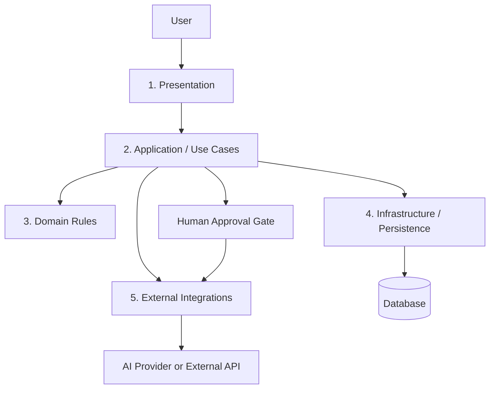

# System Architecture

## Status
Proposed logical architecture only. No runtime components have been implemented or verified.

## Five-layer architecture
1. **Presentation layer** — screens, forms, navigation, user feedback.
2. **Application layer** — use cases, orchestration, authorization, transaction boundaries.
3. **Domain layer** — business entities, rules, validation, state transitions.
4. **Infrastructure layer** — persistence, migrations, file storage, logging, configuration.
5. **Integration layer** — AI providers, social platforms, external APIs, email or other third parties.

Keep dependencies directed inward: presentation and integrations call application interfaces; domain rules should not depend on UI frameworks or vendor SDKs.

## Conceptual diagram

## Data flow
1. Receive and validate user input.
2. Authorize the requested operation.
3. Execute domain rules through an application use case.
4. Read/write persistent data through an interface where required.
5. Call external services only through integration adapters.
6. Validate and normalize external responses.
7. Return a clear result and safe error feedback to the presentation layer.

## AI inference flow
Proposed only if AI is confirmed as a requirement:
1. Build a bounded context from authorized, relevant client/project data.
2. Apply a versioned prompt and structured output schema.
3. Call the configured provider with a timeout.
4. Parse and validate output; reject malformed or unsafe responses.
5. Retry only on explicitly recoverable errors, with a bounded retry count.
6. Persist drafts/status where required.
7. Require human review before external publication.

## Approval workflow
Draft → validation → human review → approved/rejected → publication action (only if in scope) → audit result. No automatic public publishing by default.

## External integration boundaries
No integration is implemented. Provider SDKs must remain isolated behind adapters, with credentials supplied through environment configuration or a secrets manager.
